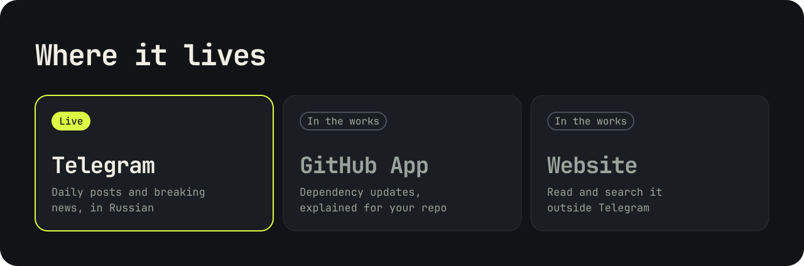
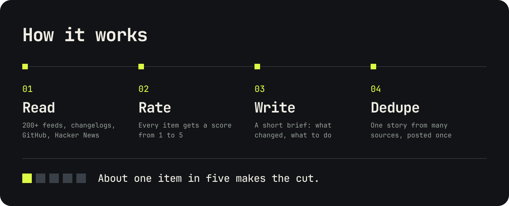
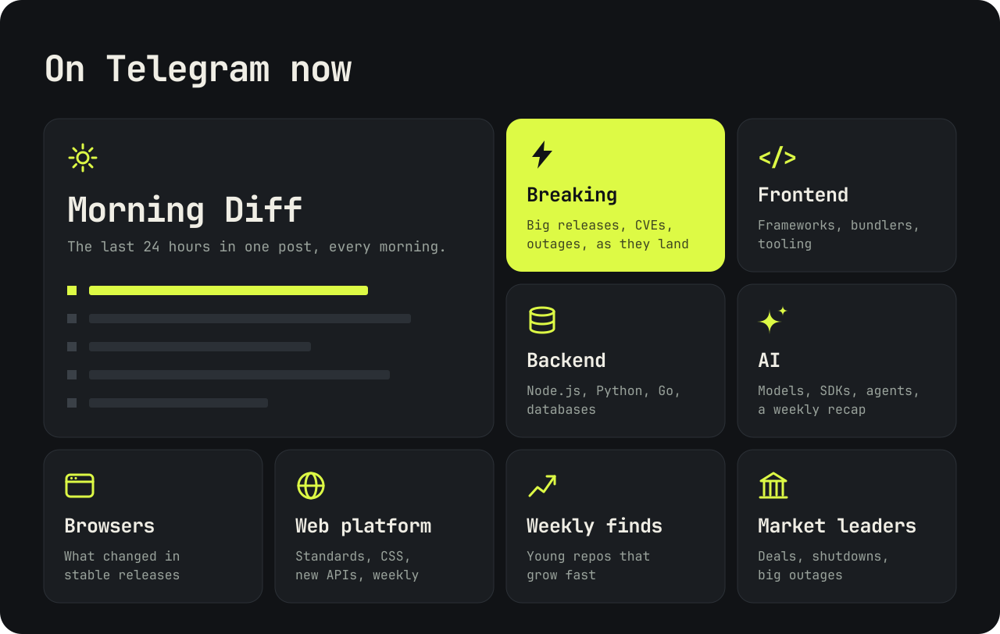

<a href="https://t.me/diff_digest">
<picture>
  <source media="(max-width: 767px)" srcset="https://raw.githubusercontent.com/diffdigest/.github/main/profile/assets/hero-narrow.svg">
  
</picture>
</a>

<picture>
  <source media="(max-width: 767px)" srcset="https://raw.githubusercontent.com/diffdigest/.github/main/profile/assets/where-narrow.svg">
  
</picture>

<picture>
  <source media="(max-width: 767px)" srcset="https://raw.githubusercontent.com/diffdigest/.github/main/profile/assets/pipeline-narrow.svg">
  
</picture>

<picture>
  <source media="(max-width: 767px)" srcset="https://raw.githubusercontent.com/diffdigest/.github/main/profile/assets/topics-narrow.svg">
  
</picture>

<a href="https://t.me/diff_digest">
<picture>
  <source media="(max-width: 767px)" srcset="https://raw.githubusercontent.com/diffdigest/.github/main/profile/assets/cta-narrow.svg">
  
</picture>
</a>

  <a href="https://t.me/diff_digest">Channel</a> &nbsp;/&nbsp;
  <a href="https://t.me/diff_digest_chat">Chat</a>

